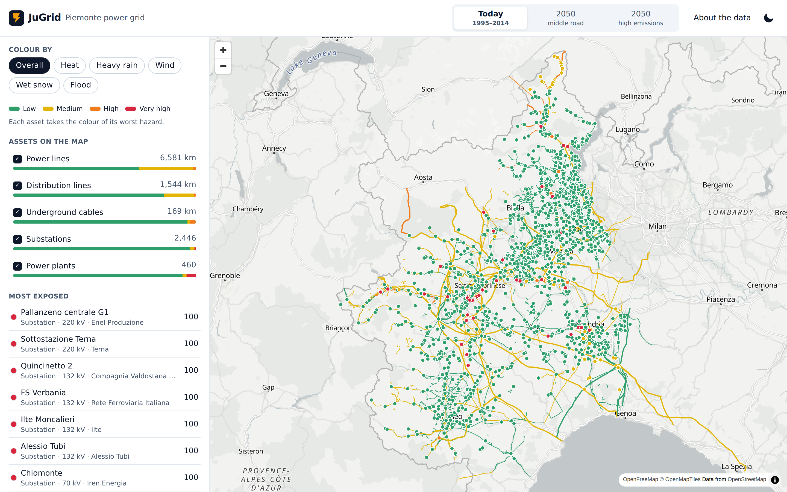
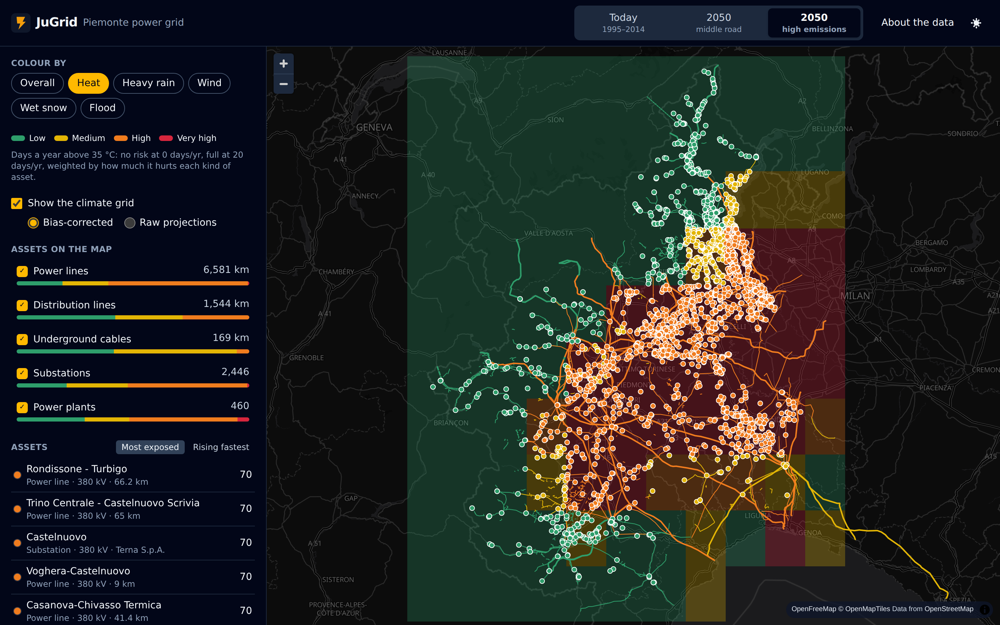
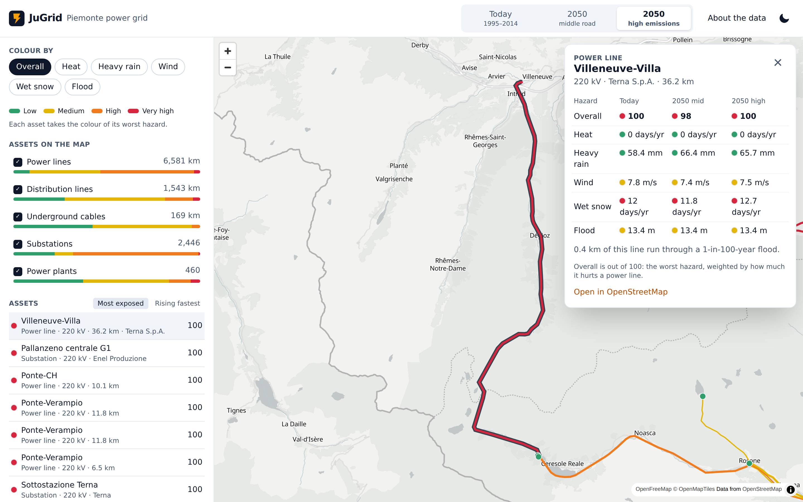
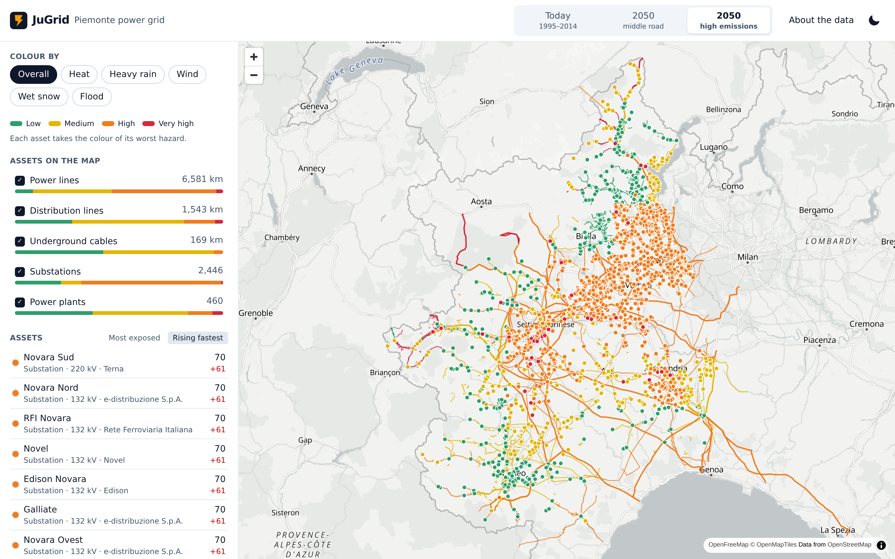
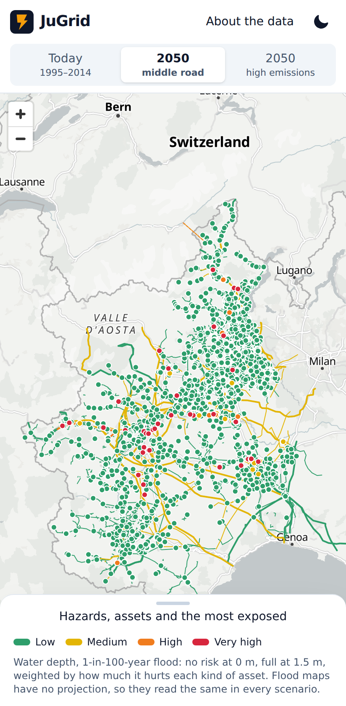
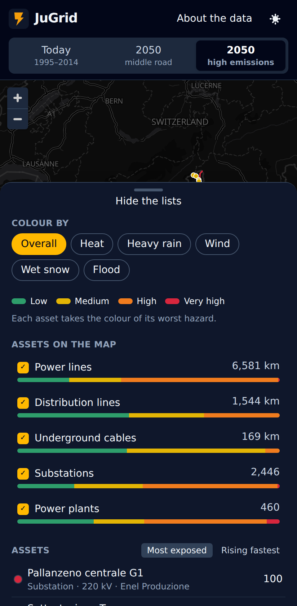

# JuGrid

Climate risk for a region's power grid. JuGrid takes every substation, plant, line and cable
OpenStreetMap knows in a region, checks each one against heat, heavy rain, wind, wet snow and
river floods, today and in 2050 under two emission paths, and shows the result on a map.
It ships set up for Piemonte; any ISO 3166-2 region works.



| Heat in 2050, high emissions, with the climate grid | One line across the three scenarios |
|---|---|
|  |  |
| **Assets whose risk grows fastest by 2050** | **On a phone** |
|  |   |

## Features

- Map of the grid coloured by overall risk or by one hazard, with the 25 km climate grid as an
  overlay.
- Three scenarios: today (1995–2014), 2050 middle road (SSP2-4.5), 2050 high emissions
  (SSP5-8.5).
- The most exposed assets, or the ones whose risk grows fastest, filtered by kind.
- Each asset's hazards side by side across scenarios, with a link to it on OpenStreetMap.
- CSV export of every asset with every score.
- Every view is a link: scenario, hazard, filters and the open asset live in the address.
- Light and dark themes, phone layout.

How the scores are made: [docs/methodology.md](docs/methodology.md).

## Quick start

Needs Docker with Compose.

```sh
git clone https://github.com/adev0x3b/jugrid.git
cd jugrid
docker compose up -d --build
docker compose run --rm ingest
```

Open http://127.0.0.1:8096.

The ingest fetches the region's assets from OpenStreetMap, the climate projections from
NASA's archive on AWS and the flood map from the JRC, then scores every asset. The first run
downloads about 60 GB of climate files, one at a time per worker, and keeps only the region's
cells (a few MB); expect an hour or two. Later runs only fetch what is missing. For a quick
look, run it with five-year periods first:

```sh
PERIOD_YEARS=5 docker compose run --rm ingest
```

Run single steps with `docker compose run --rm ingest jugrid ingest assets` (or `climate`,
`score`).

## Configuration

Compose reads `.env` (see `.env.example`):

| Variable | Default | |
|---|---|---|
| `WEB_BIND` | `127.0.0.1` | Address the web app listens on |
| `WEB_PORT` | `8096` | Port of the web app |
| `DB_PASSWORD` | `jugrid` | Database password |
| `PERIOD_YEARS` | `20` | Years in each climate period |
| `DOWNLOAD_WORKERS` | `4` | Climate files downloaded at once |

The API and the ingest read `JUGRID_*` variables; the full list is in
`backend/src/jugrid/config.py`. The ones you are most likely to change:

| Variable | Default | |
|---|---|---|
| `JUGRID_REGION_NAME` | `Piemonte` | Shown in the app |
| `JUGRID_REGION_ISO` | `IT-21` | ISO 3166-2 code OpenStreetMap is asked for |
| `JUGRID_REGION_BBOX` | `6.62,44.06,9.22,46.47` | West, south, east, north of the climate grid |
| `JUGRID_CLIMATE_MODEL` | `EC-Earth3` | Any NEX-GDDP-CMIP6 model with `r1i1p1f1` |
| `JUGRID_OVERPASS_URL` | `https://overpass-api.de/api/interpreter` | Overpass instance |

## Deploying to AWS

`infra/` is Terraform for one region of AWS:

```
CloudFront ─┬─ S3 (web app)
            └─ /api/* ─ VPC origin ─ internal ALB ─ ECS Fargate (API) ─ RDS PostgreSQL + PostGIS
                                                                       └ S3 (Zarr climate store)
EventBridge Scheduler ─ ECS Fargate (ingest, monthly) ───────────────────────┘
```

- Private subnets for the tasks and the database, one NAT gateway, an S3 gateway endpoint.
- The load balancer is internal: CloudFront reaches it through a VPC origin, and nothing else
  can. CloudFront caches API answers for the few minutes the API allows.
- The API signs in to the database with IAM tokens as a role that can only read. The ingest,
  which migrates, uses the owner's password, which RDS keeps in Secrets Manager; Terraform
  never sees it.
- One KMS key for logs, images, the database and the climate store.
- GitHub Actions deploys through OIDC: no AWS keys in the repository, and only `main` of this
  repository can assume the deploy role.

```sh
cd infra
cat > backend.hcl <<'HCL'
bucket       = "your-terraform-state-bucket"
key          = "jugrid/terraform.tfstate"
region       = "eu-south-1"
use_lockfile = true
HCL
terraform init -backend-config=backend.hcl
terraform apply
```

Then set the repository variables `AWS_DEPLOY_ROLE_ARN` (output `deploy_role_arn`) and the
ones in `deploy_settings`, and the Deploy workflow ships every green `main`. The first image
must be pushed before the API service can start, and the API can only sign in once the first
ingest has created its database role: `terraform output run_ingest` prints the command that
runs it and fills the map.

The defaults are sized for a trial: one database instance in one zone, CloudFront's own
domain, and no WAF. `waf_enabled = true` puts AWS WAF in front of CloudFront (AWS's IP
reputation, known-bad-input and core rule groups, a per-address rate limit set by
`waf_rate_limit`, blocked requests logged) for about $9 a month before traffic. `infra/.checkov.yaml` lists every check this setup skips and why.

## Development

```sh
# Pipeline and API (Python 3.14, uv); the integration tests start PostGIS with Docker
cd backend
uv sync
uv run pytest
uv run ruff check src tests && uv run mypy src tests

# Web app (Node 26) with hot reload, against the composed API
docker compose up -d --build
cd web
npm install
JUGRID_API_URL=http://127.0.0.1:8096 npm run dev
npm test && npm run lint

# Infrastructure, offline (mocked AWS provider)
cd infra
terraform init -backend=false && terraform test

# Browser tests against the composed stack, seeded with the test fixture
docker compose up -d --build --wait
docker compose exec -T api python - < backend/tests/seed_e2e.py
cd web && npx playwright test
```

The API is described at http://127.0.0.1:8096/api/openapi.json.

The screenshots above come from the Screenshots workflow (run it from the Actions tab): it
loads the real sources into the compose stack and runs `web/scripts/screenshots.ts`.

## Stack

- Pipeline and API: Python 3.14, FastAPI, SQLAlchemy, PostgreSQL with PostGIS, xarray, Zarr,
  rasterio, Shapely, httpx; pytest with Hypothesis and Testcontainers.
- Web: React 19, TypeScript, Vite, Tailwind CSS, MapLibre GL, TanStack Query; Vitest,
  Playwright with axe.
- Storage: S3 (SeaweedFS locally) for the Zarr store.
- Infrastructure: Terraform (AWS: CloudFront, ECS Fargate, RDS, S3, KMS, EventBridge
  Scheduler, IAM OIDC), tflint, checkov; GitHub Actions.

## Data

| Source | Licence |
|---|---|
| Power assets: © [OpenStreetMap](https://www.openstreetmap.org/copyright) contributors | ODbL 1.0 |
| Climate: [NASA NEX-GDDP-CMIP6](https://registry.opendata.aws/nex-gddp-cmip6/), EC-Earth3 | CC BY 4.0 |
| River flood: [Copernicus EMS / JRC global flood hazard maps](https://data.jrc.ec.europa.eu/collection/id-0054) | ODbL 1.0 |
| Base map: [OpenFreeMap](https://openfreemap.org), © OpenMapTiles, © OpenStreetMap contributors | |

A screening tool: it shows where to look, it does not assess any single asset's design or
condition.

## License

MIT
